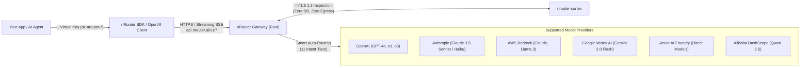

# nRouter SDK & Code Examples

[](https://www.npmjs.com/package/@nrouter_ai/sdk)
[](https://pypi.org/project/nrouter-sdk/)
[](https://pkg.go.dev/github.com/nRouterGateway/nrouter-sdk/sdks/go/v3)
[](https://crates.io/crates/nrouter)
[](https://nroutergateway.r-universe.dev/nrouter)
[](https://socket.dev/npm/package/@nrouter_ai/sdk)
[](LICENSE)

The official multi-language SDK library for [nRouter](https://nrouter.ai) — the high-performance, multi-tenant AI inference gateway. One virtual key (`sk-nrouter-*`), zero-markup list pricing, real-time guardrails, and drop-in wire compatibility for OpenAI and Anthropic SDKs across six provider clouds.

[Documentation](https://nrouter.ai/docs) • [Model Catalog & Pricing](https://nrouter.ai/models) • [Dashboard](https://app.nrouter.ai) • [API Reference](https://nrouter.ai/docs/api-reference)

---

## Architecture Overview



---

## All Ten SDKs Supported

All ten SDKs are officially maintained, tested against the identical gateway wire contract, and share coordinated releases under [Rule #14](https://github.com/nRouterGateway/nrouter-sdk#the-one-rule-that-matters-here) (v3.1.4). Every package manifest, lockfile, documentation, and installation snippet is synchronized.

| SDK | Registry / Distribution | Registry URL | Package |
|---|---|---|---|
| JavaScript / TypeScript | npm | [npmjs.com/package/@nrouter_ai/sdk](https://www.npmjs.com/package/@nrouter_ai/sdk) | `@nrouter_ai/sdk` |
| Python | PyPI | [pypi.org/project/nrouter-sdk](https://pypi.org/project/nrouter-sdk/) | `nrouter-sdk` |
| Java | Maven Central | [central.sonatype.com](https://central.sonatype.com/artifact/ai.nrouter/nrouter-sdk) | `ai.nrouter:nrouter-sdk` |
| Kotlin | Maven Central | [central.sonatype.com](https://central.sonatype.com/artifact/ai.nrouter/nrouter-sdk-kotlin) | `ai.nrouter:nrouter-sdk-kotlin` |
| Android | Maven Central | [central.sonatype.com](https://central.sonatype.com/artifact/ai.nrouter/nrouter-sdk-android) | `ai.nrouter:nrouter-sdk-android` |
| Go | Go Modules (`proxy.golang.org`) | [pkg.go.dev](https://pkg.go.dev/github.com/nRouterGateway/nrouter-sdk/sdks/go/v3) | `github.com/nRouterGateway/nrouter-sdk/sdks/go/v3` |
| Rust | crates.io | [crates.io/crates/nrouter](https://crates.io/crates/nrouter) | `nrouter` |
| Swift | Swift Package Manager | [github.com/nRouterGateway/nrouter-sdk](https://github.com/nRouterGateway/nrouter-sdk) | `nrouter-sdk` |
| Dart / Flutter | pub.dev | [pub.dev/packages/nrouter](https://pub.dev/packages/nrouter) | `nrouter` |
| R | R-universe / CRAN | [nroutergateway.r-universe.dev](https://nroutergateway.r-universe.dev/nrouter) | `nrouter` |

### Model Wire Resolution & Live Catalog

The gateway resolves provider endpoints per wire. Anthropic serves `/v1/messages` only; chat completion wires (`/v1/chat/completions`, `/v1/completions`, `/v1/responses`) serve OpenAI, Azure Foundry, Vertex AI, and Alibaba models (e.g. `gpt-5.4-mini`). Calling a model on an unserved wire returns `404 model_unavailable_on_route`.

The JS/TS SDK's `client.nr.chat()` automatically selects `/v1/messages` for `claude-*` IDs and translates the response back.

Browse available models at [nrouter.ai/api/public/models](https://nrouter.ai/api/public/models).

---

## Why Use the nRouter SDK?

1. **One API Key Across 6 Provider Clouds**: Call OpenAI, Claude, Vertex, Bedrock, and Azure models with unified billing.
2. **Built-in Spend & Observability**: Every response captures latency, model ID, and request cost (`x-nr-request-cost`).
3. **Automated Guardrails**: PII redaction, prompt injection protection, and keyword scanning apply automatically.
4. **Universal Enterprise Features**: Unified conversation memory, Jinja2 prompt variable injection, and RFC 9110 retry-after backoff across all 10 SDKs.

---

## Authentication & Environment Setup

All nRouter SDKs read your virtual API key from the `NROUTER_API_KEY` environment variable.

1. **Get an API Key**: Sign in to [app.nrouter.ai](https://app.nrouter.ai) → **API Keys** → **Create Key**. Virtual keys start with `sk-nrouter-`.
2. **Configure `.env`**:
   ```bash
   NROUTER_API_KEY="sk-nrouter-your-api-key-here"
   NROUTER_BASE_URL="https://api.nrouter.ai/v1"
   ```
3. Pass explicitly in any SDK constructor via `apiKey` / `api_key` or source from `.env`.

---

## Quick Start

### TypeScript / JavaScript
```bash
npm install @nrouter_ai/sdk
```
```typescript
import { nRouter } from "@nrouter_ai/sdk";

const client = new nRouter(); // reads NROUTER_API_KEY from environment
const res = await client.nr.chat({
  model: "claude-sonnet-4-5-20250929",
  prompt: "Hello from TypeScript!",
});
console.log(client.nr.text(res));
console.log(`Cost: $${res.meta.cost ?? "unpriced"}`);
```

### Python
```bash
pip install nrouter-sdk
```
```python
from nroutersdk import nRouter

client = nRouter()  # reads NROUTER_API_KEY from env
response = client.chat.completions.create(
    model="gpt-5.4-mini",
    messages=[{"role": "user", "content": "Hello!"}],
)
print(response.choices[0].message.content)
print(f"Cost: ${client.last_response.cost}" if client.last_response.cost else "Cost: unpriced")
```

### Java
```xml
<dependency>
    <groupId>ai.nrouter</groupId>
    <artifactId>nrouter-sdk</artifactId>
    <version>3.1.4</version>
</dependency>
```
```java
import ai.nrouter.sdk.NRouter;
import com.openai.client.OpenAIClient;
import com.openai.models.chat.completions.*;

OpenAIClient client = NRouter.create(); // reads NROUTER_API_KEY
ChatCompletion res = client.chat().completions().create(
    ChatCompletionCreateParams.builder()
        .model("gpt-5.4-mini")
        .addMessage(ChatCompletionMessageParam.ofUser(
            ChatCompletionUserMessageParam.builder().content("Hello!").build()
        ))
        .build()
);
System.out.println(res.choices().get(0).message().content());
```

### Swift
```swift
// Swift Package Manager
.package(url: "https://github.com/nRouterGateway/nrouter-sdk.git", from: "3.1.4")
```
```swift
import NRouter

let client = try NRouter() // reads NROUTER_API_KEY
let res = try await client.chatCompletions([
    "model": "gpt-5.4-mini",
    "messages": [["role": "user", "content": "Hello!"]]
])
print(res.meta.isPriced ? "Cost: $\(res.meta.cost!)" : "Cost: unpriced")
```

### Rust
```toml
# Cargo.toml
[dependencies]
nrouter = "3.1.4"
tokio = { version = "1", features = ["macros", "rt-multi-thread"] }
```
```rust
use nrouter::http::Client;
use serde_json::json;

#[tokio::main]
async fn main() -> Result<(), Box<dyn std::error::Error>> {
    let client = Client::from_env()?; // reads NROUTER_API_KEY
    let out = client.chat_completions(&json!({
        "model": "gpt-5.4-mini",
        "messages": [{"role": "user", "content": "Hello from Rust!"}]
    })).await?;
    println!("Response: {:?}", out.body);
    Ok(())
}
```

### Dart / Flutter
```yaml
# pubspec.yaml
dependencies:
  nrouter: ^3.1.4
```
```dart
import 'package:nrouter/nrouter.dart';

final client = NRouter(apiKey: 'sk-nrouter-...');
final result = await client.chatCompletions({
  'model': 'gpt-5.4-mini',
  'messages': [{'role': 'user', 'content': 'Hello from Dart!'}],
});
print(result.body['choices']);
client.close();
```

### Kotlin
```kotlin
// build.gradle.kts
repositories { mavenCentral() }
dependencies {
    implementation("ai.nrouter:nrouter-sdk-kotlin:3.1.4")
}
```
```kotlin
import ai.nrouter.sdk.NRouter
import org.json.JSONObject

val client = NRouter() // reads NROUTER_API_KEY
val res = client.chatCompletions(
    JSONObject()
        .put("model", "gpt-5.4-mini")
        .put("messages", listOf(mapOf("role" to "user", "content" to "Hello from Kotlin!")))
)
println("Cost: ${res.meta.cost?.let { "$$it" } ?: "unpriced"}")
```

### Android
```kotlin
// app/build.gradle.kts
repositories { mavenCentral() }
dependencies {
    implementation("ai.nrouter:nrouter-sdk-android:3.1.4")
}
```

### Any Other Language (OpenAI SDK Compatible)
```typescript
import OpenAI from "openai";
const client = new OpenAI({
  apiKey: process.env.NROUTER_API_KEY,
  baseURL: "https://api.nrouter.ai/v1",
});
```

---

## Verification & Conformance

Verify all SDKs against the spec contract and parity checks:
```bash
python3 conformance/check_conformance.py   # verify SDK conformance against spec
python3 scripts/check_sdk_parity.py        # playbooks and manifests parity
scripts/test-all.sh                        # run all test lanes
```


---

## Supported Endpoints

All endpoints are served by the nRouter gateway at `https://api.nrouter.ai/v1`, which
routes to the upstream providers. You never call a provider directly and you never need a
provider key. This table is derived from `spec/nrouter-sdk-spec.json` › `supported_endpoints`
(Rule #14) — edit the spec first, this table second.

| Endpoint | SDK Method | nRouter Features |
|----------|-----------|---------------|
| `POST /v1/chat/completions` | `chat.completions.create()` | Guardrails + Prompts + A/B Testing + Credits + Response cache |
| `POST /v1/completions` | `completions.create()` | Credits + Response cache |
| `POST /v1/embeddings` | `embeddings.create()` | Credits |
| `POST /v1/images/generations` | `images.generate()` | Credits |
| `POST /v1/audio/speech` | `audio.speech.create()` | Credits (text to speech) |
| `POST /v1/audio/transcriptions` | `audio.transcriptions.create()` | Credits (speech to text) |
| `POST /v1/audio/translations` | `audio.translations.create()` | Credits |
| `POST /v1/messages` | `messages.create()` | Anthropic Messages wire; Guardrails + Prompts + A/B Testing + Credits + Response cache |
| `POST /v1/messages/count_tokens` | `messages.count_tokens()` | Count before spending (free) |
| `POST /v1/responses` | `responses.create()` | OpenAI Responses wire; Guardrails + Prompts + A/B Testing + Credits + Response cache |
| `POST /v1/videos` | `videos.create()` | Start a video job (billed) |
| `GET /v1/videos/{id}` | `videos.retrieve()` | Poll job status (free) |
| `GET /v1/videos/{id}/content` | `videos.download_content()` | Download the video (free) |
| `GET /v1/models` | `models.list()` | Tenant-filtered model list |
| `GET /v1/models/{model_id}` | `models.retrieve()` | Retrieve one model |

The method column is the spec's canonical name; each language spells it in its own idiom (see that SDK's README).

### Per-request options

Also from the spec (`request_headers`, `extra_body_fields`). The body fields apply to the four text wires only.

| Option | Where | What it does |
|---|---|---|
| `nrouter_cache` | body, boolean, default `true` | Use the tenant-isolated response cache for buffered text requests. `false` forces a provider call; streams are never cached |
| `nrouter_fallbacks` | body, up to 4 model names | Per-request fallback chain, tried in order. Replaces the organization's fallback policy for this call. On `nrouter/auto` it replaces the fallbacks nrouter/auto would choose (`[]` = none). An invalid target is refused with `400 fallback_not_allowed` |
| `nrouter_optimize` | body, `"quality"` or `"cost"` | `nrouter/auto` only: the selection strategy for this one request, overriding the organization's Router Settings strategy. Any other value, or the field on another model, is refused with `400 invalid_request` |
| `nrouter_guardrails` | body, up to 8 ids or names | Guardrails to run in addition to the assigned ones; it can never remove one. An unknown id is refused with `400 guardrail_not_found` |
| `nrouter_prompt_template_id` / `nrouter_prompt_variables` | body | Select a prompt template and supply its variables |
| `x-nr-tags` | request header | Custom spend tags, `key=value,key2=value2` |
| `x-nr-compress` | request header | `on` / `off`: request prompt compression; the outcome comes back in `x-nr-compression` |
| `x-nr-trace-id` / `x-nr-session-id` | request header | Correlate your own traces and multi-turn sessions |
| `x-nr-client-language` | request header | Set automatically by each official SDK |

### Two ways to ask for a model

Routing is a gateway concern; what you put in `model` chooses the mode:

- **Direct — you choose the model.** Name it in `model`. nRouter never swaps it for another: a concrete model is never re-routed and inherits no hidden fallback. A different model answers only through a fallback you configured yourself — in Router Settings or `nrouter_fallbacks` on the request (up to 4) — and only when the provider fails (`429`, `503`, `529`, connection or first-byte stall). You are charged once, for the model that answered.
- **`nrouter/auto` — nRouter chooses an eligible model for you.** Selects between task-appropriate models by quality or lowest cost. `nrouter_optimize: "quality" | "cost"` overrides strategy for one request. `nrouter_fallbacks` on a request for `nrouter/auto` replaces the fallbacks it would choose.

In both modes you pay the served model's list price: `x-nr-model` names the model that answered, and `x-nr-routing` indicates `direct` or `fallback:<n>`.

```bash
NROUTER_MODEL=gpt-5.4-mini ./run-your-example   # direct: this model, or a fallback you configured
NROUTER_MODEL=nrouter/auto ./run-your-example   # nrouter/auto: nRouter chooses
```

The full semantics are in [`sdks/js/docs/routing.md`](sdks/js/docs/routing.md).

---

## Runnable Demos & Frameworks

Standalone starter scripts and framework integrations in `sdks/*/demo/`:

| Example / Framework | Path | Description |
|---|---|---|
| **E2E TypeScript** | [`sdks/js/demo/demo-e2e-sdk-example/`](sdks/js/demo/demo-e2e-sdk-example/) | Runnable npm consumer with error branching and cost inspection |
| **Voice Agent** | [`sdks/js/demo/voice-agent/`](sdks/js/demo/voice-agent/) | Transcriptions → chat completions → speech cascade |
| **Chat / Stream Agent** | [`sdks/js/demo/chat-agent/`](sdks/js/demo/chat-agent/) | Text wires, streaming SSE, and response cache |
| **Image Agent** | [`sdks/js/demo/image-agent/`](sdks/js/demo/image-agent/) | Image generation and billing |
| **Video Agent** | [`sdks/js/demo/video-agent/`](sdks/js/demo/video-agent/) | Video job creation and retrieval |
| **LangChain** | [`sdks/python/demo/frameworks/langchain.py`](sdks/python/demo/frameworks/langchain.py) | OpenAI-compatible LangChain client |
| **LlamaIndex** | [`sdks/python/demo/frameworks/llamaindex.py`](sdks/python/demo/frameworks/llamaindex.py) | OpenAI-compatible LlamaIndex client |
| **Vercel AI SDK** | [`sdks/js/demo/vercel_ai.ts`](sdks/js/demo/vercel_ai.ts) | `@ai-sdk/openai` integration |
| **CrewAI** | [`sdks/python/demo/frameworks/crewai.py`](sdks/python/demo/frameworks/crewai.py) | `OPENAI_API_BASE` integration |
| **AutoGen** | [`sdks/python/demo/frameworks/autogen.py`](sdks/python/demo/frameworks/autogen.py) | `base_url` config integration |

---


## Response Headers

The gateway's public `x-nr-*` response headers, and what each one means. Most
are conditional; `x-nr-request-id` and `x-nr-latency-ms` are the two present on
every response. The
authoritative set is
[`spec/gateway-response-headers.json`](spec/gateway-response-headers.json),
derived from the gateway and held against all ten SDKs by
`conformance/check_conformance.py` — this table describes the headers, and is
not itself the register of which ones exist.

| Header | Type | Description |
|--------|------|-------------|
| `x-nr-request-id` | string | Unique request ID (always present) |
| `x-nr-latency-ms` | integer | Milliseconds from edge arrival until the response headers are ready; time-to-headers, not time to the final streamed event (always present) |
| `x-nr-trace-id` | string | OpenTelemetry trace ID for this request; absent when no valid trace exists |
| `x-nr-request-cost` | float | Exact cost in USD; absent when the model is unpriced |
| `x-nr-cost-status` | string | `exact` or `unpriced` when cost metadata is available |
| `x-nr-model` | string | Model that served the request |
| `x-nr-input-tokens` | integer | Input token count |
| `x-nr-output-tokens` | integer | Output token count |
| `x-nr-total-tokens` | integer | Total token count, including cache tokens |
| `x-nr-cache-read-tokens` | integer | Cache-read tokens; emitted only when nonzero |
| `x-nr-cache-write-tokens` | integer | Cache-write tokens; emitted only when nonzero |
| `x-nr-limit-source` | string | `key`, `plan`, `team`, `user`, `budget`, `plan_window_h8`, `plan_window_day`, `plan_window_week`, `capacity`, `plan_allowance_exhausted`, or `plan_required` on 429 and 402 responses |
| `x-nr-budget-warning` | string | A soft budget you configured was crossed by this request, which still served; `<scope> soft_budget <spend>/<ceiling>`, e.g. `org soft_budget 80.00/100.00` |
| `x-nr-guardrails` | string | Pre-call guardrail posture — `none`, `monitor`, `redacted`, `pass`, `partial`, `blocked` or `unavailable`; absent means the response makes no guardrail claim, never `none`, which is an explicit token |
| `x-nr-auth-reason` | string | On a 401, the gateway's stable reason for refusing the key |
| `x-nr-response-cache` | string | `hit` or `miss`; absent when the response cache did not participate |
| `x-nr-response-cache-age` | integer | Age of a cache `hit` in seconds |
| `x-nr-funding-source` | string | Which balance paid for this request: the plan's usage allowance, credits, promotional credit (`promo`-labeled models) or hackathon credit (`hack`-labeled models) (`allowance`, `credits`, `promo` or `hack`) |
| `x-nr-pot-fallback` | string | Present only when a request for a `promo`- or `hack`-labeled model was charged to prepaid credits because the organization turned on paid fallback in Settings; names why the pot did not fund it (`pot_empty`, `pot_insufficient`, `window_hour`, `window_day`, `window_week`, `window_month`, `platform_day`, `platform_month`, `policy_excluded`, `feature` or `fallbacks_ineligible`). Absent otherwise |
| `x-nr-allowance-reset` | integer | Seconds until the tightest usage-allowance window resets; sent on allowance-window 429s (equal to `Retry-After`) and the monthly 402 `plan_allowance_exhausted` |
| `x-nr-routing` | string | Which chain entry answered: `direct` for the first, `fallback:<n>` for the entry n fallbacks deep; absent on cache hits and refusals |
| `x-nr-attempts` | integer | Provider calls made for this request, retries and failovers alike; absent on cache hits and refusals |
| `x-nr-compression` | string | Prompt compression outcome: `applied`, `not_requested`, `off` or `skipped` |
| `x-nr-intent` | string | Top intent category, when intent routing was requested |
| `x-nr-model-deprecated` | boolean | Present when the served model is deprecated and will be retired |
| `x-nr-deprecation-notice` | string | Notice and successor guidance for a deprecated model |

Python SDK captures these automatically in `client.last_response`. Other languages read them from HTTP response headers. The two deprecation headers are the newest: read them from the raw response headers until your SDK version surfaces them as typed metadata.

---

## Error Codes

The gateway classifies refusals into typed error codes:

| Code | HTTP | Exception Class | Description |
|------|------|-----------------|-------------|
| `invalid_request` | 400 | `nRouterRequestError` | Invalid JSON or request shape |
| `guardrail_blocked` | 400 | `nRouterGuardrailBlockedError` | A guardrail denied the request (pre-call) or withheld the response (post-call) |
| `invalid_api_key` | 401 | `nRouterAuthenticationError` | Virtual-key authentication refused; see `x-nr-auth-reason` |
| `insufficient_credits` | 402 | `nRouterCreditError` | Reserve failed; nothing was spent |
| `model_not_found` | 404 | `nRouterNotFoundError` | Model unknown or not visible to this key; a former model alias name is now an unknown model |
| `rate_limit_exceeded` | 429 | `nRouterRateLimitError` | A rate limit was exceeded (RPM, TPM, RPS or RPD), or an 8-hour/daily/weekly `nrouter/auto` allowance window is used up (`x-nr-limit-source`: `plan_window_h8`, `plan_window_day` or `plan_window_week`; `Retry-After` and `x-nr-allowance-reset` carry the wait in seconds). With extra usage turned on in Billing, allowance overflow is funded from credits instead of refused; see `x-nr-limit-source` |
| `tpm_limit_exceeded` | 429 | `nRouterRateLimitError` | TPM limit exceeded; see `x-nr-limit-source` |
| `credit_check_failed` | 503 | `nRouterServiceError` | Credit system unavailable |
| `service_unavailable` | 503 | `nRouterServiceError` | A required gateway dependency is unavailable |
| `plan_allowance_exhausted` | 402 | `nRouterCreditError` | The plan's monthly usage allowance is used up (HTTP 402; the 8-hour, daily and weekly windows answer 429 `rate_limit_exceeded` instead). It resets at the next billing period (see `x-nr-allowance-reset`); no `Retry-After` is sent. With extra usage turned on in Billing, allowance overflow is funded from credits instead of refused. |
| `plan_required` | 402 | `nRouterCreditError` | An organization's legacy subscription plan usage allowance is paused pending payment. Pay-as-you-go organizations are served `nrouter/auto` and named models from credits and do not receive this code. `promo`- and `hack`-labeled models are funded from their promotional or hackathon credit first (falling back to credits only when the organization has turned on paid fallback, or never held that credit) and never receive this code. |
| `input_too_large` | 400 | `nRouterRequestError` | The input exceeds the served model's context window. Refused before any provider call; nothing was spent |
| `max_output_tokens_too_large` | 400 | `nRouterRequestError` | The requested output ceiling exceeds what the served model allows. It is not clamped for you; lower it |
| `model_denied_by_org` | 403 | `nRouterError` | The requested model, or a model named in `nrouter_fallbacks`, is on the organization's model deny list. A deny always wins over an allow list, and a denied model is also removed from `nrouter/auto` and `promo`/`hack` pot eligibility. Refused before any provider egress; nothing was reserved and nothing was spent |
| `model_denied_by_team` | 403 | `nRouterError` | The requested model, or a model named in `nrouter_fallbacks`, is on the deny list of the team this virtual key belongs to. A deny always wins over an allow list, and a denied model is also removed from `nrouter/auto` and `promo`/`hack` pot eligibility. Refused before any provider egress; nothing was reserved and nothing was spent |
| `model_denied_by_key` | 403 | `nRouterError` | The requested model, or a model named in `nrouter_fallbacks`, is on this virtual key's own model deny list. A deny always wins over an allow list, and a denied model is also removed from `nrouter/auto` and `promo`/`hack` pot eligibility. Refused before any provider egress; nothing was reserved and nothing was spent |
| `fallback_not_allowed` | 400 | `nRouterRequestError` | A model in `nrouter_fallbacks` is not a valid fallback target for this key; nothing was spent |
| `insufficient_promo_credit` | 402 | `nRouterCreditError` | A request for a `promo`-labeled model was refused because the organization's available promotional credit cannot cover the request's hold and prepaid credits could not be used: paid fallback is not turned on in Settings (the message names that remedy), or the prepaid balance cannot cover the hold either. Also returned when nRouter has frozen the organization's promotional credit (paid fallback does not apply). Promotional credit has no cash value and is spent only on `promo`-labeled models. Refused before any provider egress; nothing was reserved and nothing was spent |
| `insufficient_hack_credit` | 402 | `nRouterCreditError` | A request for a `hack`-labeled model was refused because the organization's available hackathon credit cannot cover the request's hold and prepaid credits could not be used: paid fallback is not turned on in Settings (the message names that remedy), or the prepaid balance cannot cover the hold either. Also returned when nRouter has frozen the organization's hackathon credit (paid fallback does not apply). Hackathon credit has no cash value and is spent only on `hack`-labeled models. Refused before any provider egress; nothing was reserved and nothing was spent |
| `pot_spend_limit_exceeded` | 429 | `nRouterRateLimitError` | A `promo`- or `hack`-funded request would take the organization's spend on that pot past one of its windows (set by nRouter; by default hourly none, daily $1, weekly $7, monthly $30; `x-nr-limit-source`: `pot_window`) and prepaid credits could not be used: paid fallback is not turned on in Settings (the message names that remedy), or no prepaid credit balance was available to overflow into. Windows are UTC calendar buckets: the hour, the day, the ISO week starting Monday 00:00 UTC, and the month. The message names the window that refused and when it resets; nothing was reserved and nothing was spent |
| `pot_route_feature_unsupported` | 400 | `nRouterRequestError` | A `promo`- or `hack`-funded request asked for a feature those pots do not fund when no prepaid credit balance is available: web search (`nrouter_web_search`), more than one choice (`n > 1`), or a tool-billed feature, and prepaid credits could not be used (paid fallback is not turned on in Settings, or no prepaid balance). Nothing was reserved and nothing was spent; remove the feature, or turn on paid fallback and hold prepaid credits |
| `guardrail_not_found` | 400 | `nRouterRequestError` | A guardrail in `nrouter_guardrails` is not owned by this organization; refused rather than ignored |
| `image_input_unsupported` | 400 | `nRouterRequestError` | The request to `nrouter/auto` includes an image, and no model available for automatic routing on this endpoint accepts image input. Remove the image or name a model that accepts images; nothing was spent |

---

## Structure

This is the standalone public `nRouterGateway/nrouter-sdk` repository:

```
nrouter-sdk/
├── README.md                        ← You are here (single reference for all)
├── LANGUAGES.md                     ← every-language guide (any OpenAI-format client)
├── spec/nrouter-sdk-spec.json       ← Source of truth (headers, errors, endpoints, Rule #14)
├── spec/gateway-response-headers.json ← The gateway's emitted x-nr-* header names
├── conformance/                     ← Cross-SDK contract gate (check_conformance.py)
├── scripts/                         ← test-all.sh, security-audit.sh, sast.sh
├── examples/ · notebooks/           ← Standalone samples and the quickstart notebook
├── sdks/
│   ├── python/                      ← Branded SDK → pip install nrouter-sdk (demo/ included)
│   ├── js/                          ← Branded SDK → npm install @nrouter_ai/sdk (demo/ included)
│   ├── java/                        ← Branded SDK → Maven ai.nrouter:nrouter-sdk (demo/ included)
│   ├── kotlin/                      ← Branded SDK → Maven ai.nrouter:nrouter-sdk-kotlin (demo/ included)
│   ├── android/                     ← Branded SDK → Maven ai.nrouter:nrouter-sdk-android (demo/ included)
│   ├── swift/                       ← SwiftPM package from root git tag (demo/ included)
│   ├── rust/                        ← Branded SDK → crates.io nrouter (demo/ included)
│   ├── dart/                        ← Branded SDK → pub.dev nrouter (demo/ included)
│   ├── go/                          ← Branded SDK → tagged Go module (demo/ included)
│   └── r/                           ← Branded SDK → R-universe public preview (demo/ included)
```

## Documentation & Links

- **Documentation**: [nrouter.ai/docs](https://nrouter.ai/docs)
- **API Reference**: [nrouter.ai/docs/api-reference](https://nrouter.ai/docs/api-reference)
- **Live Model Catalog**: [nrouter.ai/models](https://nrouter.ai/models)
- **Pricing**: [nrouter.ai/pricing](https://nrouter.ai/pricing)
- **Dashboard**: [app.nrouter.ai](https://app.nrouter.ai)
- **Routing Guide**: [`sdks/js/docs/routing.md`](sdks/js/docs/routing.md)

---

## Contributing, Security & License

| Document | Purpose |
|---|---|
| [CONTRIBUTING.md](CONTRIBUTING.md) | How to build and test each SDK. Develop on `development`; `main` only via PR (Rule #20). |
| [SECURITY.md](SECURITY.md) | Report vulnerabilities privately to `security@nrouter.ai`. |
| [SUPPORT.md](SUPPORT.md) | Bug reports and account assistance. |
| [CHANGELOG.md](CHANGELOG.md) | Coordinated release notes for shared version `3.1.4`. |
| [LICENSE](LICENSE) | MIT License. |

